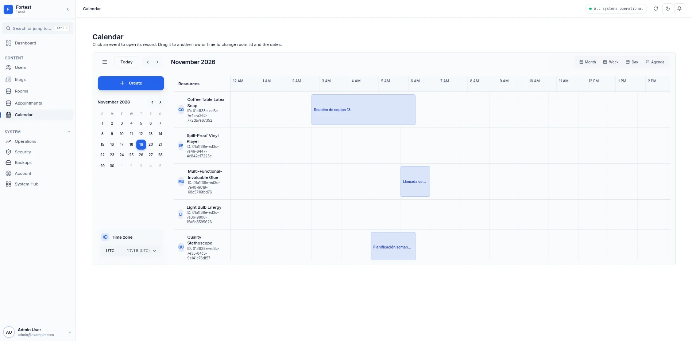
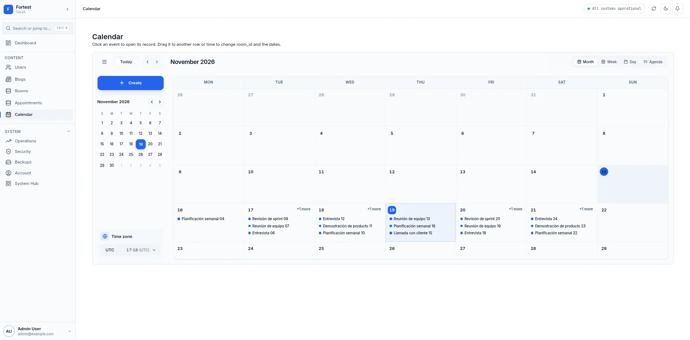
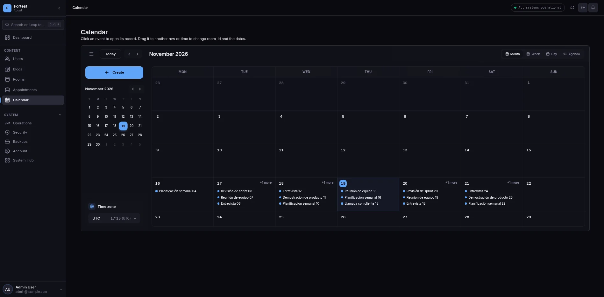
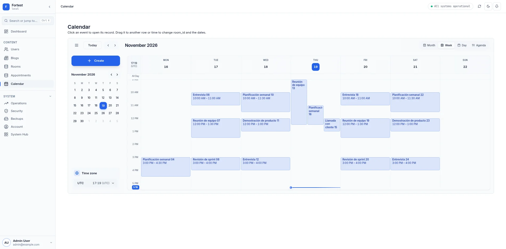
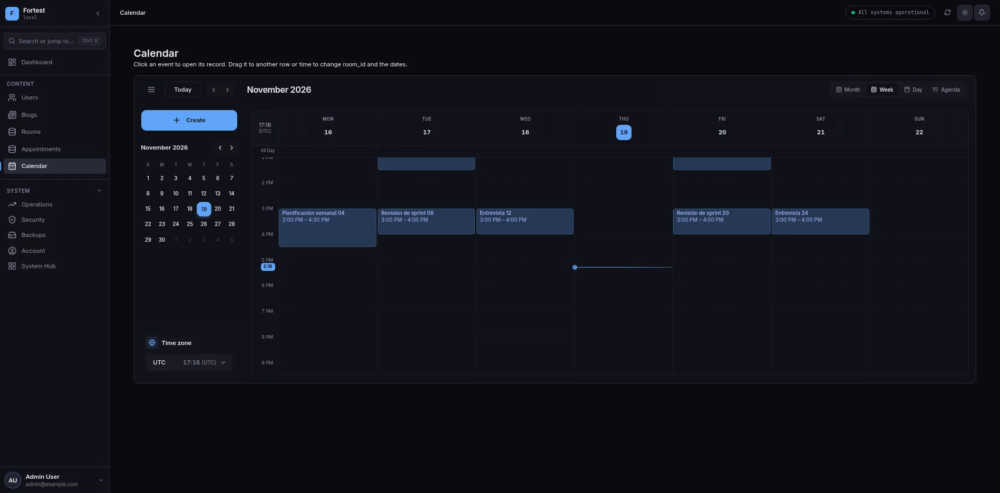
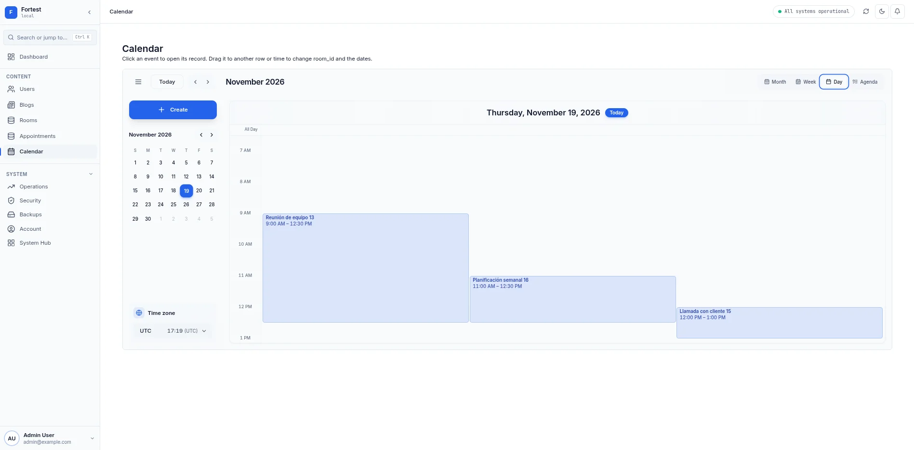
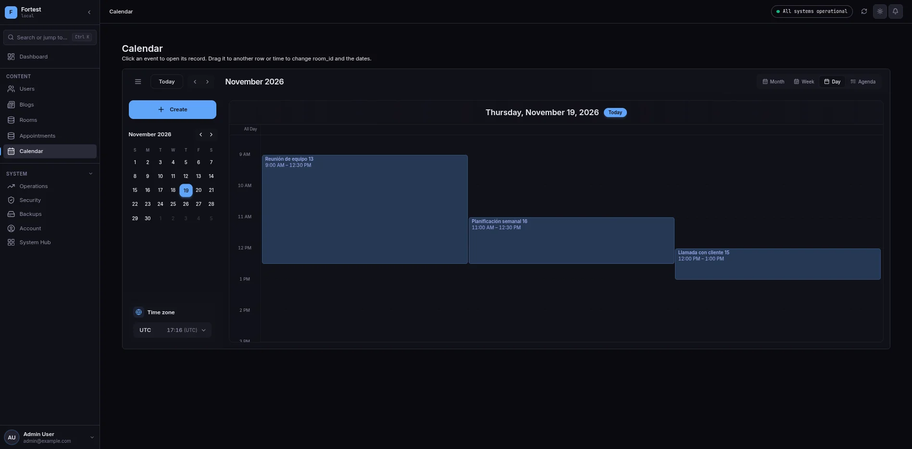
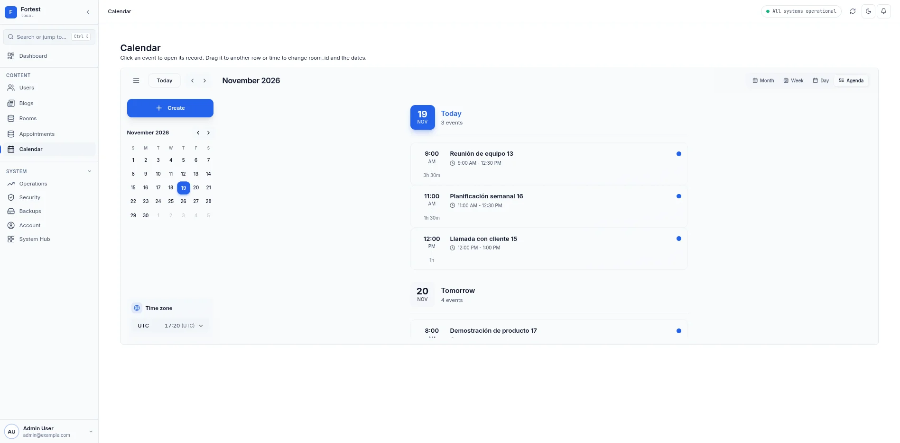
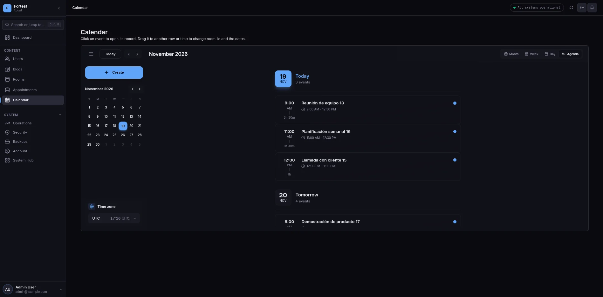
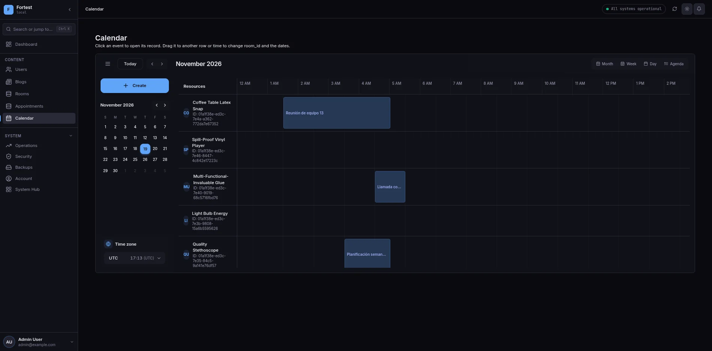

# grit-calendar

A community plugin for Grit. It installs one or more resource calendars and an
optional dashboard widget, using [CalendarKit Pro](https://calendarkit.io/)
2.0.0 (MIT) for the views, the time grid and drag and drop.

Each calendar reads two generated resources:

- the **event** resource supplies events from a `datetime` field;
- the **row** resource supplies the lanes through a relationship field on the
  event (rooms, people, equipment).

Click an event opens its generated record page. Dragging changes its date and
row through the resource's PATCH route. Editing uses a form built from Grit's
own `ResponsiveSheet`, `Input`, `Button` and `ConfirmModal`, limited to the
fields listed in the config.

The repository was started with `grit plugin new calendar` and keeps that
workflow, with component tests added for the flows that used to regress.



<details>
<summary>All five views, light and dark</summary>

| View | Light | Dark |
|---|---|---|
| Month |  |  |
| Week |  |  |
| Day |  |  |
| Agenda |  |  |
| Resource |  |  |

</details>

## Status

This is a beta release. It is usable in the supported architectures below, but
it is not translated and it does not cover every Grit shape yet. See
[Limitations](#limitations).

## Install

```bash
grit plugin add github.com/daljo25/grit-calendar
pnpm install
```

Requires **Grit 3.558.0 or newer**. The manifest writes through the `// grit:`
markers and the `{{ADMIN_ROOT}}` placeholder that release added, so an older CLI
stops with `marker "// grit:nav:imports" not found` instead of installing a
calendar with no sidebar link. An existing project gets the markers from
`grit upgrade`.

The plugin is in the community index, which is what `grit plugin list` and the
marketplace page read. Community plugins install by repository, so the command
above stays the one to use.

## Configuration

Everything is in **`apps/admin/config/calendar.ts`** for Next.js projects and
**`apps/admin/src/config/calendar.ts`** for TanStack projects. The file is
documented line by line with the options, defaults and effects of every
setting. Edit a value, save, and the dev server hot-reloads. Reinstalling is
never needed.

`CALENDARS` is an array so one install can serve several calendars, for example
one for admins and one for members. The first entry owns `/calendar`; the rest
live at `/calendar/<id>`. The sidebar and the widget derive from the same array.

| Setting | What it does |
|---|---|
| `id` | URL segment for `/calendar/<id>`; the first entry is `/calendar` |
| `nav.label`, `nav.iconKey`, `nav.adminOnly`, `nav.requires` | Sidebar link and its visibility |
| `widget.enabled`, `widget.title`, `widget.max` | Dashboard feed of upcoming events |
| `event.slug`, `lane.slug` | The two resources; empty means auto-detect |
| `event.*Field`, `lane.*Field` | Field names used to map records to events and rows |
| `editing.canEdit` | `false` makes the calendar read only, including drag |
| `editing.canCreate` | `false` hides Create; `true` redirects to the resource create screen |
| `editing.canDelete` | `false` hides Delete in the sheet and the right-click menu; `true` confirms first |
| `editing.fields` | Resource fields the edit sheet may change |
| `editing.openOnClick` | `"detail"` opens the record page, `"edit"` opens the edit sheet |
| `timezone` | IANA zone; `UTC` keeps a 09:00 database value at 09:00 |
| `theme` | `"grit"` follows the admin's theme tokens; other values are CalendarKit presets |

## Supported projects

Version 0.6.0 supports:

- **triple + Next.js**: admin code in `apps/admin`
- **triple + Vite/TanStack**: admin code in `apps/admin/src`

Both get the same features, with frontend-specific files for routing and links.
The manifest writes `{{ADMIN_ROOT}}`, which Grit resolves to wherever the panel
lives, so the two shapes share one entry per file. Double and single projects
resolve their admin root too, but their routing has not been tested, so every
entry still carries `architecture: ["triple"]` and they install nothing.

## Repository layout

Source lives under `files/`, grouped by the shape it lands in, the way Grit's
own `grit plugin new` groups `files/api/` and `files/admin/`:

| Directory | Installed into | Use for |
|---|---|---|
| `files/shared/` | both shapes | files whose body is identical for Next.js and TanStack |
| `files/next/` | the admin root | files only Next.js needs |
| `files/tanstack/` | the admin root | files only TanStack needs |

Paths under each directory are relative to the admin root, so the mapping is
mechanical: `files/tanstack/routes/_dashboard/calendar.tsx` is written to
`{{ADMIN_ROOT}}/routes/_dashboard/calendar.tsx`, which is
`apps/admin/src/routes/...` on a Vite project and `apps/admin/routes/...` on a
Next one. Each source directory is one `directories` entry in the manifest.

Two consequences worth knowing before editing:

- A file belongs in `shared/` only if both shapes can run the same body. The
  relative path `components/calendar/calendar-create-intent.tsx` exists in both
  shapes with different content, because the import of `next/navigation` versus
  `@/lib/next-compat` is the whole difference. Do not infer shared-ness from the
  path.
- `plugin.json` maps directories rather than files, so adding a component to
  `files/shared/components/calendar/` installs it with no manifest change.
  Adding a *directory* still needs an entry.

## Limitations

- API-only and mobile projects have no admin panel, so the plugin installs
  nothing there and says so. Double and single projects resolve their admin
  root correctly now, but their routing has not been tested: the manifest keeps
  an `architecture: ["triple"]` clause until it has.
- The UI strings are English. No Grit plugin ships translations yet; i18n is
  planned for a later version. Half of it is cheap when it comes: CalendarKit
  takes a `translations` object of its own, so the library's labels are a small
  addition next to the plugin's.
- The create-intent test runs in the Next.js admin only, because the component
  it covers is the Next one. The other two tests run in both shapes since Grit
  3.555.0, which fixed the Vite admin's `vitest.config.ts` pointing `@` at the
  app root rather than `src/`
  ([grit#229](https://github.com/MUKE-coder/grit/issues/229)).
- Each lane header shows `ID: <record id>` under its label. That line is
  hardcoded in CalendarKit 2.0.0 and its `translations.idLabel` falls back to
  the same text when empty (`translations?.idLabel || "ID: {id}"`), so there is
  no supported way to remove it. Hiding it would take a third CSS rule of the
  kind listed above, and the record id is the lane's own key, so it is left
  visible.
- CalendarKit has no public prop for hiding its floating Create button or the
  Delete item in its right-click menu. Two CSS rules scoped to the calendar root
  hide those controls, and they depend on the class names used by CalendarKit
  **2.0.0**. That is why the npm dependency is pinned to the exact version
  instead of a caret range. If the library is upgraded, those selectors need
  checking.
- Creating a row from CalendarKit redirects to the resource's own create
  screen, which is the only place that knows every required field.

## Verification

```bash
go build -o /tmp/grit ./cmd/grit        # from a Grit checkout
GRIT_BIN=/tmp/grit ./tests/verify.sh
```

The script scaffolds triple Next and triple Vite projects, installs the plugin,
checks the files and injections, removes it and checks again.

CI runs three shapes: triple Next, triple Vite and an API-only project that must
stay untouched. Both admins are type-checked, with the Vite one generating its
TanStack route tree first, since a route that disagrees with its path only fails
there. Both suites run too, with the plugin's own tests inside them; only the
`?action=create` test is Next-only, because the component it covers is.

## License

MIT. See [LICENSE](LICENSE). Contributions are covered by the same license.

Release steps, the verification a pull request should pass and the rules the
source follows are in [CONTRIBUTING.md](CONTRIBUTING.md).
